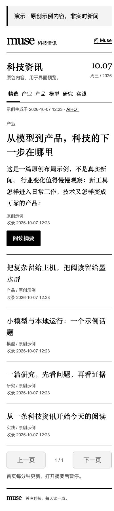

# Kindle Muse Reader

**把闲置 Kindle 变成一台安静的科技资讯阅读器。**

一个为墨水屏设计的家庭局域网应用：Linux 主机同步 AIHOT 科技资讯，Kindle 用自带浏览器阅读；可选接入 Meta Muse Gadget SDK，在独立页面提问并阅读完整回答。

[安装与配对](docs/INSTALL.md) · [配置说明](docs/CONFIGURATION.md) · [架构](docs/ARCHITECTURE.md) · [安全](SECURITY.md) · [English](docs/README.en.md)



*浏览器预览，使用本项目编写的示例文字；不是实时新闻或 Kindle 真机照片。*

## 能做什么

- 首页直接阅读科技资讯，按 **精选 / 产业 / 产品 / 模型 / 研究 / 实践** 筛选。
- 每分钟检查 AIHOT 更新，支持 ETag、304、限流退避和持久缓存；断网时保留最后成功内容并提示时间。
- 每页十条，长摘要与回答分页；正文和提问页面不自动刷新。
- 显示摘要、推荐理由、原文链接、原文发布日期与收录时间，不推断缺失日期。
- 可选 Muse 问答：独立 `/ask` 页面、完整回答回传、历史记录、重复提交保护。
- 黑白大字号、单列布局、服务端 HTML，无 JavaScript、远程字体或图片依赖。

资讯模式只需要 Python 和外网访问；Muse 模式另外需要 Linux、蓝牙 LE、可用的 Muse 账号、SDK 令牌和手机配对。

## 五分钟启动：先试资讯模式

需要 **Python 3.10+**（macOS 或 Linux）。下载仓库后进入根目录：

```sh
python3 src/bridge.py --host 127.0.0.1 --port 8766 --state-dir ./state
```

用本机浏览器打开 `http://127.0.0.1:8766/`。首次运行自动生成八位访问码，在你自己的终端查看：

```sh
cat state/access_code
```

访问码属于私密配置，不要提交到 Git。首次同步可能需要等待约一分钟。没有配置 Muse 时，资讯照常可读，提问按钮显示待配对并禁用。

要让 Kindle 使用，将 `--host` 换成 **桥接主机自己的局域网 IPv4 地址**，然后在同一网络的 Kindle 浏览器打开 `http://主机局域网地址:8766/`。主机需要持续运行；不要把服务暴露到公网。

需要开机启动或接入 Muse？继续阅读 [Linux 安装与配对](docs/INSTALL.md)。

## 离线预览

```sh
python3 scripts/demo.py
```

打开 `http://127.0.0.1:8767/`，访问码在 `state/demo/access_code`。这个模式只使用原创示例文章，不联网、不连接 Muse、不模拟 AI 回答，供布局预览。

## 验证和支持范围

```sh
python3 -m unittest discover -s tests -v
python3 scripts/check_public_tree.py
```

测试覆盖登录与跨站提交、完整回答和送达确认的区别、去重、重启恢复、长文分页、受限设备命令、新闻日期、缓存纠正与撤选、限流、栏目隔离和界面行为。未安装可选 SDK 时，SDK 专属测试会明确跳过；CI 另有安装固定版本 SDK 的完整测试任务。

Kindle Paperwhite 4 的自带浏览器曾完成真实问答和资讯摘要阅读。不同 Kindle 固件的页面、输入法和休眠行为仍需各自验证。当前首页新布局经过 340px / 417px 浏览器检查；不能把预览图当作所有设备的兼容证明。

目前不包含自动读书、划词提问、KOReader 插件、语音或图片输入。浏览器地址栏仍由 Kindle 控制；实验性原生全屏入口不属于本次发布。更新是分钟级轮询，网页不能唤醒休眠的 Kindle。后台投递接口保留，但首页没有收件箱入口，且仓库没有预设任何个人定时任务。

## 内容与许可证

本项目代码采用 [Apache-2.0](LICENSE)，第三方依赖见 [NOTICE](NOTICE)。这是独立社区项目，与 Meta、Amazon 或 AIHOT 没有官方关联。

**代码开源不等于新闻数据获得再发布许可。** AIHOT 允许个人非商业、公益非商业和组织内部使用；公开镜像、批量公开再分发、对外商业产品等需要事先书面授权。请核对 [AIHOT 使用规则](https://aihot.news/terms) 与 [官方 API 文档](https://aihot.news/openapi-v1.json)。仓库仅提供客户端代码和原创演示，不附带真实资讯缓存或原文全文。

Muse SDK 源码许可证与 Muse 云服务条款是不同事项；使用云服务前需自行获取账号和令牌、阅读 [Gadget SDK Terms](https://gadgets.muse.ai/sdk-terms)。本项目不会提供账号、网络代理或共享令牌。

欢迎贡献兼容性反馈、排版改进和测试，见 [CONTRIBUTING.md](CONTRIBUTING.md)。
