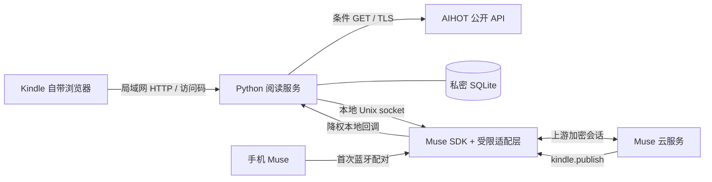

# 架构与边界

Kindle 只是显示和输入终端。外网连接、缓存、SDK 和蓝牙在 Linux 主机上；资讯模式也可在 macOS 本地运行。Kindle 不直接安装官方 SDK，本项目的浏览器模式不要求越狱或写入 Kindle 文件。

## 模块

- `src/bridge.py`：HTTP 登录、HMAC 单次请求、问答状态、分页、SQLite 持久化与本地回调服务。
- `src/reader_ui.py`：黑白排版、分类、来源和长文展示。
- `src/aihot_feed.py`：匿名公开 API、条件请求、响应大小限制、链接验证、独立栏目缓存和退避。
- `src/muse_service.py`：继承独立安装的上游服务；保留配对与加密传输，替换命令注册表和执行器。
- `src/publish_reply.py`：在低权限账户下把有限回调提交到阅读服务 socket。
- `src/news_sources.py`：仅向固定出版机构 HTTPS 主机取日期元数据，用于可选后台新闻投递；不负责 AIHOT 聚合摘要的事实核验。

## 问答状态

`sending → waiting → complete / failed`。上游接受消息只代表送达确认；收到 `kindle.publish` 的完整文本才算完成。回调可能早于送达确认，完成状态不能被晚到确认覆盖。相同请求和相同回答重放是幂等的；相同编号的不同内容会拒绝。

每次提问使用独立会话编号，不自动带入历史上下文。五分钟未收到完整回答会失败。重启时将结果未知的请求标记失败，不自动重发，避免重复任务。

## 允许的设备命令

| 命令 | 作用 |
| --- | --- |
| `kindle.publish(job_id, text)` | 回传已存在请求的完整纯文本回答，最多 60000 字符 |
| `kindle.notify(delivery_id, title, text)` | 保存主动投递；稳定 ID 去重，最多每小时 30 条新消息 |
| `kindle.news_source(url)` | 核验允许的来源日期；旧闻、未来日期、未知日期不能作为今天新闻 |

未注册上游通用 shell、任意文件读写和设备健康命令；执行器也会拒绝这些调用。适配层依赖上游私有接口，故固定 SDK 提交，更新前必须重新测试。

以 `kindle-news-` 开头的投递要求正文包含来源 URL，所有 URL 两小时内核验成功且投递时仍属过去 24 小时内。核验日期不等于核实摘要所有事实；模型须自行阅读可靠原文。此接口不会创建定时任务，也不会唤醒 Kindle。

## 资讯状态

每个模式保存 ETag、下次检查时间、成功时间、错误和有序快照。200 在一个事务中替换快照，包括修改和撤选；304 保留数据；错误保留最后成功内容并标明失败。只有提供的标题、摘要、推荐理由与出处被展示，不猜单篇全文 API、不抓取授权门禁后的正文。

外部内容是不可信资料，HTML 会转义。发布仓库没有运行中的数据库、真实文章数据、用户记录或 Kindle 固件。
